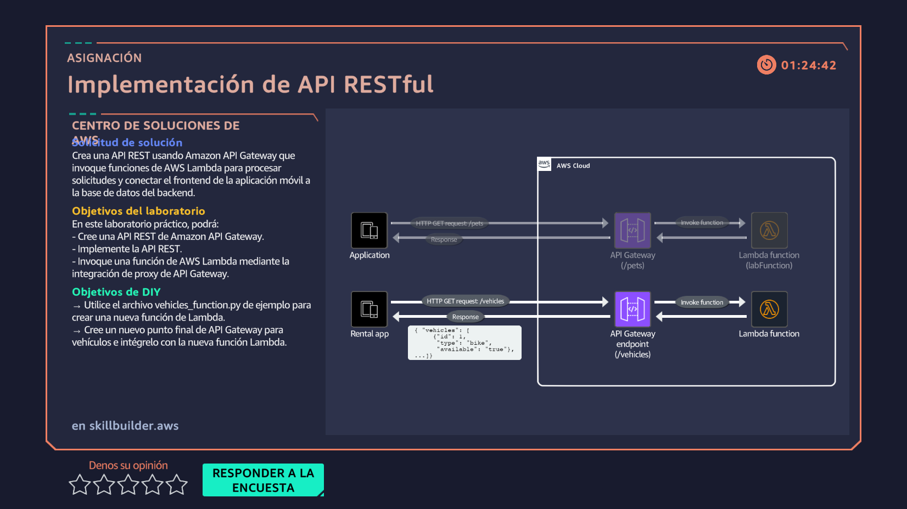
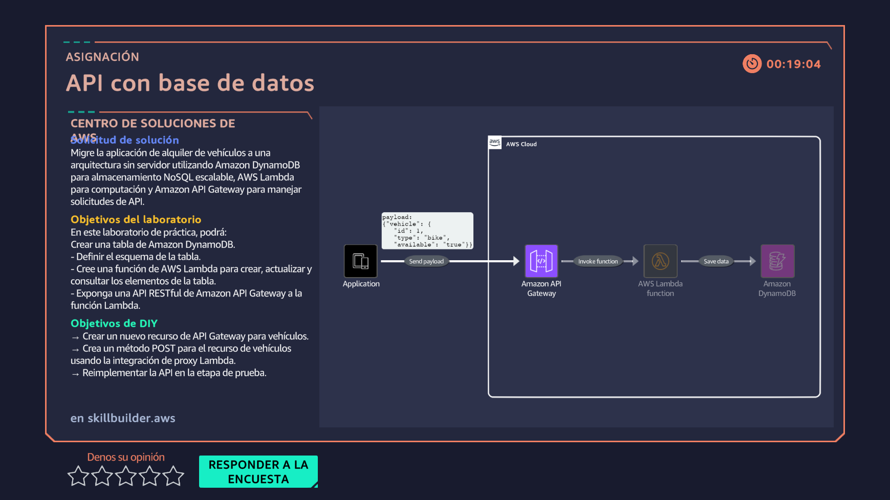
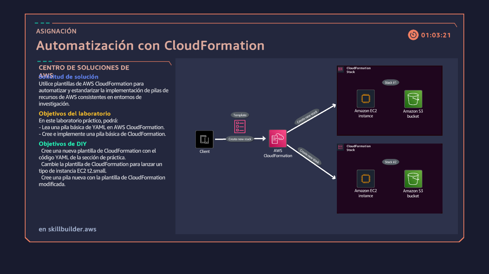
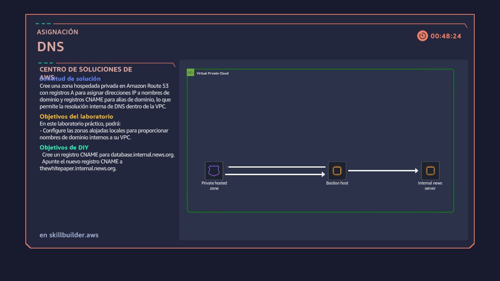
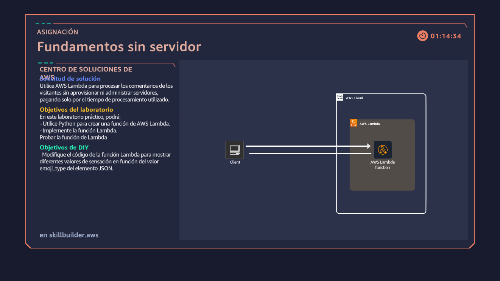
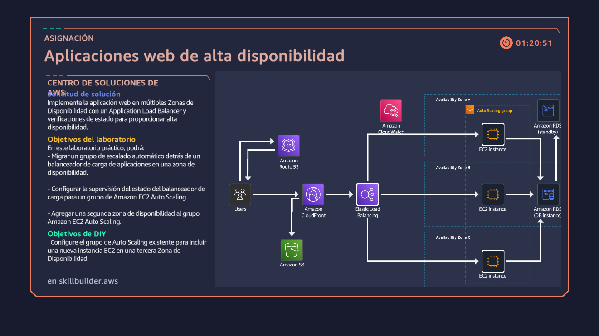
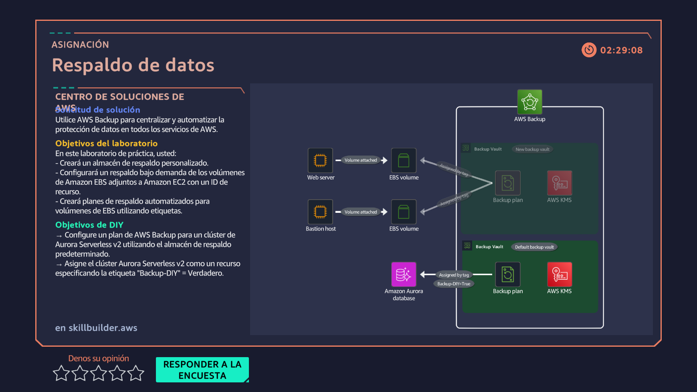

# Ruta Architecting - AWS Solutions Associate

Este repositorio contiene los laboratorios prácticos para la ruta de certificación de **AWS Solutions Architect Associate**. A través de estos ejercicios, aprenderás a implementar soluciones arquitectónicas en la nube de AWS, desde servicios serverless hasta arquitecturas de alta disponibilidad.

## Resumen

Los laboratorios están diseñados para proporcionarte experiencia práctica con los servicios más importantes de AWS, incluyendo:

- **Serverless**: Implementación de funciones Lambda y API Gateway
- **Bases de datos**: DynamoDB NoSQL y APIs con backend escalable
- **Infraestructura como Código**: Automatización con CloudFormation
- **Redes**: Configuración de DNS privado con Route 53
- **Alta Disponibilidad**: Balanceadores de carga, Auto Scaling y múltiples AZs
- **Protección de datos**: Respaldos automatizados con AWS Backup

Cada laboratorio incluye un caso de uso real, diagramas de arquitectura, pasos detallados e información sobre los conceptos clave y servicios AWS involucrados.

---

## Índice de Laboratorios

| # | Laboratorio | Archivo | Caso de Uso | Servicios AWS |
|---|---|---|---|---|
| 1 | [API Restful](#laboratorio-api-restful) | [lab_api_restful.md](laboratorios/lab_api_restful.md) | Aplicación mobile para rentar y ubicar scooters en un parque de diversiones | API Gateway, Lambda |
| 2 | [Implementar API Restful](#laboratorio-implementar-api-restful) | [lab_implement_API_restful.md](laboratorios/lab_implement_API_restful.md) | Conectar frontend mobile a backend de vehículos mediante API REST | API Gateway, Lambda |
| 3 | [API REST con DynamoDB](#laboratorio-api-rest-con-dynamodb) | [lab_API_DataBase.md](laboratorios/lab_API_DataBase.md) | Migrar base de datos SQL a solución NoSQL escalable para alquiler de vehículos | API Gateway, Lambda, DynamoDB |
| 4 | [CloudFormation](#laboratorio-automatización-cloudformation) | [lab_automatizacion_cloudformation.md](laboratorios/lab_automatizacion_cloudformation.md) | Automatización del aprovisionamiento de infraestructura | CloudFormation, EC2, S3 |
| 5 | [DNS](#laboratorio-dns-con-route-53) | [lab_dns.md](laboratorios/lab_dns.md) | Servidor interno de noticias con acceso DNS privado para empleados | Route 53, EC2, VPC |
| 6 | [Serverless](#laboratorio-fundamentos-serverless) | [lab_fund_serverless.md](laboratorios/lab_fund_serverless.md) | Sistema de recopilación de comentarios de visitantes sin gestionar servidores | Lambda, CloudWatch, S3, DynamoDB |
| 7 | [Alta Disponibilidad](#laboratorio-alta-disponibilidad-web) | [lab_high_availability_web_app.md](laboratorios/lab_high_availability_web_app.md) | Aplicación web de agencia de viajes distribuida en múltiples AZ | ALB, Auto Scaling, EC2, CloudFront |
| 8 | [Respaldo de Datos](#laboratorio-respaldo-de-datos) | [lab_respaldo_datos.md](laboratorios/lab_respaldo_datos.md) | Solución de backups unificada para empresa de consultoría de marketing | AWS Backup, EBS, KMS, EC2 |

---

## Laboratorios Detallados

### Laboratorio API Restful

**Caso de Uso**: Aplicación para un parque de diversiones que permite a los clientes rentar y ubicar scooters eléctricos dentro del parque.

**Descripción**: Este laboratorio cubre la implementación de una API RESTful utilizando Amazon API Gateway y AWS Lambda. Conectas el frontend con el backend mediante integración proxy de Lambda, creando una arquitectura serverless que escala automáticamente sin gestionar servidores.

**Laboratorio completo**: [Ver laboratorio completo](laboratorios/lab_api_restful.md)

**Servicios AWS**: API Gateway, Lambda, DynamoDB/RDS

**Conceptos Clave**:
- API RESTful y sus principios arquitectónicos (GET, POST, PUT, DELETE)
- Amazon API Gateway como puerta de entrada gestionada
- Integración proxy de Lambda
- Stages y control de versiones de API
- Comunicación stateless entre frontend y backend
- Escalabilidad automática sin gestionar servidores

**Imagen de Referencia**:

**Recursos Adicionales**:
- [Documentación oficial de API Gateway](https://docs.aws.amazon.com/apigateway/latest/developerguide/welcome.html)
- [Documentación de AWS Lambda](https://docs.aws.amazon.com/lambda/latest/dg/welcome.html)
- [Integración Lambda con API Gateway](https://docs.aws.amazon.com/apigateway/latest/developerguide/api-gateway-lambda-function-handler.html)

---

### Laboratorio Implementar API Restful

**Caso de Uso**: Conectar la aplicación mobile de alquiler de vehículos eléctricos a su base de datos backend, permitiendo acceso a datos en tiempo real sobre ubicación, estado y disponibilidad de autos y scooters.

**Descripción**: Implementación práctica de una API RESTful usando API Gateway y Lambda. Se crea la función Lambda con código Python, se definen los recursos y métodos HTTP, y se despliega la API en un stage. Incluye pruebas de endpoints con parámetros de ruta dinámicos.

**Laboratorio completo**: [Ver laboratorio completo](laboratorios/lab_implement_API_restful.md)

**Servicios AWS**: API Gateway, Lambda, CloudWatch

**Conceptos Clave**:
- Integración Lambda Proxy en API Gateway
- Recursos y métodos HTTP en API Gateway (GET con parámetros de ruta)
- Roles de ejecución IAM para Lambda
- Deploy de API a un stage con URL de invocación
- Parámetros de ruta dinámicos (`{id}`)
- Testing de funciones Lambda con eventos JSON
- Ciclo solicitud-respuesta en APIs REST

**Imagen de Referencia**:

**Recursos Adicionales**:
- [Documentación de API Gateway](https://docs.aws.amazon.com/apigateway/latest/developerguide/welcome.html)
- [Lambda Proxy Integration](https://docs.aws.amazon.com/apigateway/latest/developerguide/set-up-lambda-proxy-integrations.html)
- [Testing de funciones Lambda](https://docs.aws.amazon.com/lambda/latest/dg/testing-functions.html)

---

### Laboratorio API REST con DynamoDB

**Caso de Uso**: Empresa de alquiler de vehículos cuya base de datos SQL relacional no puede manejar el volumen de usuarios concurrentes. Necesitan migrar a una solución NoSQL escalable y rentable.

**Descripción**: Implementa una arquitectura serverless completa con DynamoDB, Lambda y API Gateway. Creas una tabla NoSQL, una función Lambda con variables de entorno para conectar con DynamoDB, y expones la lógica como API REST con métodos GET y POST. Se incluye teoría sobre SQL vs NoSQL, CORS y métodos HTTP.

**Laboratorio completo**: [Ver laboratorio completo](laboratorios/lab_API_DataBase.md)

**Servicios AWS**: API Gateway, Lambda, DynamoDB, IAM, CloudWatch

**Conceptos Clave**:
- Amazon DynamoDB: base de datos NoSQL totalmente administrada
- Clave de partición y clave de ordenación en DynamoDB
- SQL vs NoSQL: esquema, escalabilidad y casos de uso
- Integración Lambda Proxy en API Gateway
- Variables de entorno en Lambda
- CORS (Cross-Origin Resource Sharing)
- Métodos HTTP y códigos de estado (200, 201, 400, 404, 500)
- Operaciones Scan vs Query en DynamoDB
- Roles IAM con principio de menor privilegio
- Stages de API Gateway y URL de invocación

**Imagen de Referencia**:

**Recursos Adicionales**:
- [Documentación de Amazon DynamoDB](https://docs.aws.amazon.com/amazondynamodb/latest/developerguide/Introduction.html)
- [DynamoDB: Query vs Scan](https://docs.aws.amazon.com/amazondynamodb/latest/developerguide/bp-query-scan.html)
- [CORS en API Gateway](https://docs.aws.amazon.com/apigateway/latest/developerguide/how-to-cors.html)
- [Documentación de AWS Lambda](https://docs.aws.amazon.com/lambda/latest/dg/welcome.html)

---

### Laboratorio Automatización CloudFormation

**Caso de Uso**: Automatización del aprovisionamiento de infraestructura creando stacks de recursos de AWS de forma repetible y controlada por versiones.

**Descripción**: Aprende a modelar y aprovisionar recursos de AWS utilizando plantillas de CloudFormation en formato YAML o JSON. Creas una EC2, un grupo de seguridad y un bucket S3 de forma automatizada. Incluye despliegue de múltiples stacks para demostrar la reutilización de plantillas con control de versiones.

**Laboratorio completo**: [Ver laboratorio completo](laboratorios/lab_automatizacion_cloudformation.md)

**Servicios AWS**: CloudFormation, EC2, S3, Security Groups

**Conceptos Clave**:
- Infraestructura como Código (IaC)
- Plantillas de CloudFormation en YAML o JSON
- Recursos: EC2, Security Groups, S3
- Referencia entre recursos con `!Ref`
- Stacks y control de versiones
- `DeletionPolicy` y ciclo de vida de recursos
- CloudFormation Composer (interfaz visual)
- Rollback automático ante fallos

**Imagen de Referencia**:

**Recursos Adicionales**:
- [Documentación oficial de CloudFormation](https://docs.aws.amazon.com/cloudformation/latest/userguide/welcome.html)
- [Crear stacks en CloudFormation](https://docs.aws.amazon.com/cloudformation/latest/userguide/cfn-console-create-stack.html)
- [Mejores prácticas de CloudFormation](https://docs.aws.amazon.com/AWSCloudFormation/latest/UserGuide/best-practices.html)

---

### Laboratorio DNS con Route 53

**Caso de Uso**: Servidor interno de noticias para empleados de una empresa, accesible solo mediante nombres de dominio privados dentro de la VPC, sin exposición a internet.

**Descripción**: Configura una zona hospedada privada en Amazon Route 53 para resolver nombres de dominio internos. Creas registros A y CNAME para mapear IPs a nombres legibles, y usas un Bastion Host para verificar la conectividad desde dentro de la VPC.

**Laboratorio completo**: [Ver laboratorio completo](laboratorios/lab_dns.md)

**Servicios AWS**: Route 53, EC2, VPC, Systems Manager (Session Manager)

**Conceptos Clave**:
- Amazon Route 53 y zonas hospedadas privadas
- Registros DNS tipo A (mapeo directo IP → dominio)
- Registros DNS tipo CNAME (alias de dominio)
- Servidores Bastion (Jump Host) para acceso seguro
- Resolución DNS interna dentro de VPC
- Nameservers (NS) y registros SOA
- Patrones de arquitectura segura con subnets privadas

**Imagen de Referencia**:

**Recursos Adicionales**:
- [Documentación oficial de Route 53](https://docs.aws.amazon.com/route53/latest/developerguide/Welcome.html)
- [Trabajar con Hosted Zones](https://docs.aws.amazon.com/route53/latest/developerguide/hosted-zones-working-with.html)
- [Tipos de registros DNS en Route 53](https://docs.aws.amazon.com/route53/latest/developerguide/ResourceRecordTypes.html)

---

### Laboratorio Fundamentos Serverless

**Caso de Uso**: Sistema de recopilación de comentarios y calificaciones de visitantes de un parque de diversiones, sin necesidad de aprovisionar o mantener servidores.

**Descripción**: Implementa una función Lambda que procesa comentarios de clientes. Aprende sobre el paradigma serverless, tipos de invocación síncrona y asíncrona, monitoreo con CloudWatch Logs y el ecosistema completo de servicios serverless de AWS.

**Laboratorio completo**: [Ver laboratorio completo](laboratorios/lab_fund_serverless.md)

**Servicios AWS**: Lambda, CloudWatch, S3, DynamoDB, API Gateway, SNS, SQS, Step Functions

**Conceptos Clave**:
- AWS Lambda: funciones sin servidor totalmente administradas
- Triggers y tipos de invocación (síncrona vs asíncrona)
- Plataforma serverless AWS (S3, DynamoDB, API Gateway, SNS, SQS, EventBridge)
- CloudWatch Logs: métricas START, END y REPORT
- Escalabilidad automática y metering por milisegundos
- Concurrencia y reserva de capacidad (máx. 1000 por región)
- Roles de ejecución IAM para Lambda

**Imagen de Referencia**:

**Recursos Adicionales**:
- [Documentación oficial de Lambda](https://docs.aws.amazon.com/lambda/latest/dg/welcome.html)
- [Invocación de Lambda](https://docs.aws.amazon.com/lambda/latest/dg/lambda-invocation.html)
- [CloudWatch Logs](https://docs.aws.amazon.com/cloudwatch/latest/logs/WhatIsCloudWatchLogs.html)

---

### Laboratorio Alta Disponibilidad Web

**Caso de Uso**: Aplicación web de agencia de viajes desplegada en múltiples zonas de disponibilidad con balanceo de carga y auto escalado para garantizar disponibilidad continua.

**Descripción**: Configura una arquitectura de alta disponibilidad usando Application Load Balancer, Auto Scaling Groups y health checks. La app se despliega en múltiples AZs para garantizar redundancia. Incluye configuración de grupos de seguridad con tráfico controlado entre ALB y EC2.

**Laboratorio completo**: [Ver laboratorio completo](laboratorios/lab_high_availability_web_app.md)

**Servicios AWS**: ELB/ALB, Auto Scaling, EC2, CloudWatch, CloudFront, VPC, Security Groups

**Conceptos Clave**:
- Amazon Application Load Balancer (ALB): listeners, target groups y routing
- Auto Scaling Groups: capacidad mínima, deseada y máxima
- Health checks: unhealthy threshold, timeout e interval
- Múltiples Zonas de Disponibilidad (AZ) para redundancia
- Amazon CloudFront para CDN y distribución global
- Security Groups: control de tráfico entre ALB y EC2
- Subnets públicas para balanceadores de carga

**Imagen de Referencia**:

**Recursos Adicionales**:
- [Documentación de Elastic Load Balancing](https://docs.aws.amazon.com/elasticloadbalancing/latest/application/introduction.html)
- [Auto Scaling para EC2](https://docs.aws.amazon.com/autoscaling/ec2/userguide/what-is-amazon-ec2-auto-scaling.html)
- [Zonas de Disponibilidad en AWS](https://docs.aws.amazon.com/AWSEC2/latest/UserGuide/using-regions-availability-zones.html)

---

### Laboratorio Respaldo de Datos

**Caso de Uso**: Empresa de consultoría de marketing que necesita reemplazar múltiples scripts personalizados de backup por una solución de respaldo unificada, automatizada y centralizada para sus recursos AWS.

**Descripción**: Implementa una estrategia de respaldo centralizada usando AWS Backup para proteger volúmenes EBS e instancias EC2. Creas una bóveda de respaldo con cifrado KMS, realizas backups bajo demanda y configuras planes automatizados basados en etiquetas, eliminando la necesidad de scripts personalizados.

**Laboratorio completo**: [Ver laboratorio completo](laboratorios/lab_respaldo_datos.md)

**Servicios AWS**: AWS Backup, Amazon EBS, AWS KMS, EC2, IAM, CloudTrail

**Conceptos Clave**:
- AWS Backup: servicio centralizado y automatizado de protección de datos
- Backup Vault (Bóveda de respaldo) con cifrado KMS
- Backup Plan: frecuencia, retención y ciclo de vida
- Asignación de recursos por etiquetas (`Backup: True`)
- On-Demand Backup (respaldo inmediato bajo demanda)
- EBS Snapshots y coherencia crash-consistent
- AWS KMS y Customer Managed Keys (CMK)
- RTO (Recovery Time Objective) y RPO (Recovery Point Objective)
- Integración con AWS Organizations para gobernanza multi-cuenta
- FIPS 140-2: estándar de seguridad de módulos criptográficos

**Imagen de Referencia**:

**Recursos Adicionales**:
- [Documentación de AWS Backup](https://docs.aws.amazon.com/aws-backup/latest/devguide/whatisbackup.html)
- [Amazon EBS Snapshots](https://docs.aws.amazon.com/AWSEC2/latest/UserGuide/EBSSnapshots.html)
- [Documentación de AWS KMS](https://docs.aws.amazon.com/kms/latest/developerguide/overview.html)
- [Planes de respaldo en AWS Backup](https://docs.aws.amazon.com/aws-backup/latest/devguide/creating-a-backup-plan.html)
- [AWS Backup con AWS Organizations](https://docs.aws.amazon.com/aws-backup/latest/devguide/manage-cross-account.html)

---

## Requisitos del Workshop

Para completar estos laboratorios, necesitarás configurar tu entorno de desarrollo. Elige una de las siguientes opciones:

### Opción 1: Consola AWS (Recomendado para principiantes)
- Una cuenta de AWS activa
- Acceso a la consola de gestión de AWS
- Permisos suficientes para crear recursos (EC2, Lambda, API Gateway, DynamoDB, etc.)

### Opción 2: Entorno de Desarrollo Local
- **Editor de código recomendado**: VS Code
- **AWS CLI** instalado y configurado (`aws configure`)
- **AWS Toolkit** para VS Code (opcional)
- **CloudFormation Linter** para validar plantillas YAML/JSON

### Requisitos específicos por laboratorio

| Laboratorio | Servicios Requeridos | Nivel de Dificultad | Tiempo Estimado |
|---|---|---|---|
| API Restful | API Gateway, Lambda | Principiante | 45-60 min |
| Implementar API Restful | API Gateway, Lambda | Principiante | 1 hora |
| API REST con DynamoDB | API Gateway, Lambda, DynamoDB | Intermedio | 1-2 horas |
| CloudFormation | CloudFormation, EC2, S3 | Principiante | 1 hora |
| DNS | Route 53, EC2, VPC | Intermedio | 1-2 horas |
| Serverless | Lambda, CloudWatch | Principiante | 45-60 min |
| Alta Disponibilidad | ALB, Auto Scaling, EC2 | Avanzado | 2-3 horas |
| Respaldo de Datos | AWS Backup, EBS, KMS | Intermedio | 1-2 horas |

### Recomendaciones

1. **Cuenta AWS**: Si no tienes una, crea una cuenta gratuita con el nivel [AWS Free Tier](https://aws.amazon.com/free)
2. **Región**: Usa `us-east-1` (N. Virginia) para la mayoría de laboratorios
3. **Orden sugerido**: Serverless → CloudFormation → API Restful → DNS → API + DynamoDB → Alta Disponibilidad → Respaldo de Datos
4. **Validación**: Instala [CloudFormation Linter](https://github.com/aws-cloudformation/cfn-lint) para validar plantillas antes del despliegue
5. **Costos**: Consulta la [calculadora de precios de AWS](https://calculator.aws/) antes de comenzar
6. **Limpieza**: Elimina los recursos y stacks al finalizar cada laboratorio para evitar cargos

### Recursos Adicionales Generales

- [Documentación oficial de AWS](https://docs.aws.amazon.com)
- [AWS Training and Certification](https://aws.amazon.com/training/)
- [AWS Architecture Center](https://aws.amazon.com/architecture/)
- [Well-Architected Framework](https://aws.amazon.com/architecture/well-architected/)
- [AWS Solutions Architect Associate - Guía oficial](https://aws.amazon.com/certification/certified-solutions-architect-associate/)

---

*¡Buena suerte en tu aprendizaje de AWS!* 🚀
